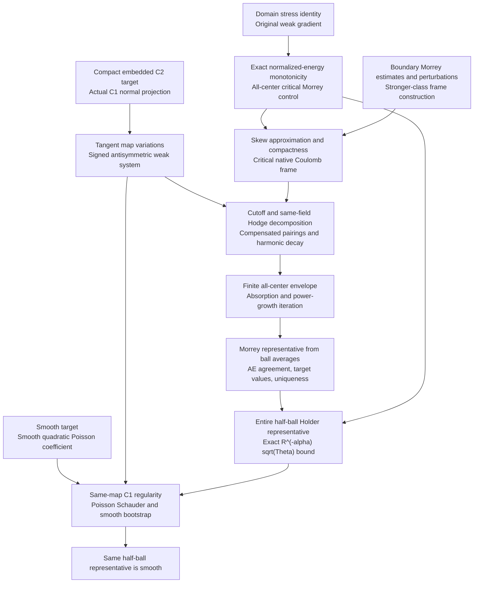

# Small-energy regularity for stationary harmonic maps in Lean 4

[](https://github.com/BrookWW/SmallEnergyRegularityStationaryHarmonicMaps/actions/workflows/build.yml)
[](https://github.com/BrookWW/SmallEnergyRegularityStationaryHarmonicMaps/actions/workflows/kernel.yml)

A complete Lean 4 proof of **interior small-energy regularity for stationary
weakly harmonic maps into compact embedded C² targets**, in every source
dimension $n\ge2$. The result gives a unique continuous, target-valued
representative on the entire inner half ball and the scale-correct quantitative
Hölder estimate. For smooth targets, the same representative is smooth.

The proof constructs the geometric coefficient, critical Coulomb frame,
compensated decay and continuous representative from the stated geometric and
variational assumptions. These analytic steps are proved in Lean. There are no
additional unformalized analytic inputs or draft theorem exports. The permitted
axioms are Lean's standard `propext`, `Classical.choice` and `Quot.sound`.

The repository is one Lake project containing the three libraries
`StationaryHarmonicMaps`, `HarmonicMaps` and `HolderToCK`. Their required source
modules are included here; Mathlib is the sole direct external Lake dependency.
The mathematical proof is presented independently in
[paper/main.tex](paper/main.tex) ([PDF](paper/main.pdf));
[docs/regularity.md](docs/regularity.md) explains its correspondence with the
formal development.

## What is proved

Let $n\ge2$, and let $N\subset\mathbb R^q$ be a nonempty compact embedded C²
submanifold without boundary, with its induced Euclidean metric. Let
$\Omega\subset\mathbb R^n$ be open. Suppose
$u\in W^{1,2}_{\mathrm{loc}}(\Omega,\mathbb R^q)$ takes values in $N$ almost
everywhere, is weakly harmonic under all compactly supported C¹ tangent map
variations, and satisfies the domain-stationarity stress identity. Set

```math
E(u;B)=\int_B |Du|_{\mathrm{HS}}^2\,dx,
\qquad
\Theta_u(a,R)=R^{2-n}E(u;B_R(a)).
```

Energy has **no factor of $1/2$**. The same displayed weak gradient `Du`
appears in Sobolev membership, the variational identities and the energy.
The target is an actual compact Euclidean subset with a C² manifold structure
and embedded inclusion. No orientation or global normal frame is required.

**Quantitative Hölder regularity.** There exist $\varepsilon\gt0$,
$0\lt\alpha\lt1$ and $C\ge0$, depending only on $n,N$, such that
$\overline{B_R(a)}\subset\Omega$ and $\Theta_u(a,R)\le\varepsilon$ imply a
unique continuous representative $w:B_{R/2}(a)\to\mathbb R^q$. It takes values
in $N$ at every point and satisfies

```math
|w(x)-w(y)|
\le C R^{-\alpha}\sqrt{\Theta_u(a,R)}\,|x-y|^\alpha,
\qquad x,y\in B_{R/2}(a).
```

The constants precede the domain, map, weak gradient, center and radius.
Uniqueness is among all continuous representatives agreeing almost everywhere
with the original map on the half ball. The proof takes $\alpha=1/2$ and
includes $n=2$ and zero energy.

**Smooth-target corollary.** If $N$ is a compact smooth embedded target, this
same representative is C∞ on $B_{R/2}(a)$, retaining the displayed quantitative
Hölder estimate and uniqueness. The public smooth corollary asserts smoothness
and this Hölder bound; all-order quantitative derivative bounds are not part
of its statement.

The advertised results concern interior regularity for stationary harmonic
maps. Boundary regularity, singular-set estimates and a regularity theorem for
arbitrary Euclidean-valued antisymmetric systems are separate statements.

## Computable constants from certified geometry

**Given verified embedding data, both $\varepsilon_*$ and $C$ are fully
computable.** The numerical input is a certified normal-projection extension
and a rational derivative bound; no extraction algorithm from an arbitrary
abstract target is asserted.

The numerical interface proves the same conclusion with explicit rational
functions of $n,q,\ell$. Supply a certified compactly supported C¹ ambient
extension $G$ of the target's orthogonal normal projection and a rational
$\ell\ge0$ satisfying $\|DG(y)\|\le\ell$ at every ambient point.
Here $DG(y)$ has the induced operator norm from Euclidean space to matrices
with their operator norm; gradient and coefficient energies use the
Hilbert–Schmidt norm. Set

```math
M=(1+4q\ell^2)4^{n-2},\qquad K=(1+C_g)(1+M),
\qquad
\varepsilon_* = \left(\frac{\min(\kappa,\theta)}K\right)^2,
\qquad C=2C_rK.
```

Here $\kappa,C_g$ are the proved critical Coulomb threshold and coefficient;
$\theta,C_r$ are the proved given-frame smallness and Hölder coefficient.
Their entire defining arithmetic uses natural numbers and rationals. The
[paper's constant ledger and self-contained algorithm](paper/main.tex)
expand every coefficient, including Sobolev, Hardy, projection, boundary,
moment and iteration constants. The functions are
[`effectiveStationaryEnergyThreshold`](StationaryHarmonicMaps/Analysis/EffectiveStationaryConstants.lean)
and `effectiveStationaryHolderConstant`. The fixed theorem interfaces are
[EffectiveSmallEnergyRegularity](StationaryHarmonicMaps/Frozen/EffectiveSmallEnergyRegularity.lean)
and [EffectiveSmallEnergySmoothRegularity](StationaryHarmonicMaps/Frozen/EffectiveSmallEnergySmoothRegularity.lean).
[EffectiveRegularity](StationaryHarmonicMaps/EffectiveRegularity.lean) is their
import facade; both are also exported by `StationaryHarmonicMaps`.

Every abstract compact embedded C² target admits a suitable $G,\ell$, as
proved in [EffectiveNormalProjectionData](StationaryHarmonicMaps/Geometry/EffectiveNormalProjectionData.lean).
Evaluating constants for a specified embedding requires certifying this
geometric data, including the derivative bound throughout the ambient
extension region. The existence theorem for an abstract target does not
provide a numerical algorithm extracting that certificate. The original
existential regularity theorem obtains it internally and retains its original
hypotheses. Computing the constants requires no computation of the map or frame.

For the numerical inputs $n=2,q=3,\ell=1$, the actual functions evaluate to
$\varepsilon_*\approx2.227969608538\times10^{-6428}$ and
$C\approx2.951399297746\times10^{5772}$.
These are conservative admissible bounds. This input example does not certify
$\ell=1$ for a particular target embedding. The exact rational numerators and
denominators are recorded in
[verification/effective-constants.json](verification/effective-constants.json)
and reproduced by `python3 scripts/check_effective_constants.py`.

## Lean interface

Import both main results with:

```lean
module
public import StationaryHarmonicMaps

#check StationaryHarmonicMaps.stationary_small_energy_regularity
#check StationaryHarmonicMaps.stationary_small_energy_smooth_regularity
```

The following standalone example states the complete C²-target interface and
uses the public theorem directly.

```lean
module
public import StationaryHarmonicMaps

open HarmonicMaps MeasureTheory Set
open StationaryHarmonicMaps
set_option autoImplicit false

example {n q : ℕ} (hn : 2 ≤ n) (N : CompactC2EmbeddedTarget q) :
    ∃ ε α C : ℝ, 0 < ε ∧ 0 < α ∧ α < 1 ∧ 0 ≤ C ∧
      ∀ (Ω : OpenDomain n) (u : Domain n → Ambient q)
        (Du : Domain n → Gradient n q),
        MemW12Loc Ω u Du →
        (∀ᵐ x ∂volume.restrict Ω.val, u x ∈ N.carrierSet) →
        IsWeaklyHarmonicByTangentVariations N Ω u Du →
        IsDomainStationary Ω Du →
        ∀ (a : Domain n) (R : PositiveRadius),
          Metric.closedBall a R.val ⊆ Ω.val →
          normalizedEnergy Du a R ≤ ENNReal.ofReal ε →
          ∃ w : Metric.ball a (R.val / 2) → Ambient q,
            IsContinuousRepresentative (ballDomain a (R.val / 2)) u w ∧
            (∀ x, w x ∈ N.carrierSet) ∧
            (∀ x y,
              ‖w x - w y‖ ≤ C * Real.rpow R.val (-α) *
                Real.sqrt (normalizedEnergy Du a R).toReal *
                Real.rpow (dist (x : Domain n) (y : Domain n)) α) ∧
            ∀ v : Metric.ball a (R.val / 2) → Ambient q,
              IsContinuousRepresentative (ballDomain a (R.val / 2)) u v → v = w :=
by exact stationary_small_energy_regularity hn N
```

`Domain n` and `Ambient q` are Euclidean spaces. `MemW12Loc` uses genuine
distributional derivatives and local L² integrability. The definition
`IsContinuousRepresentative` includes continuity and almost-everywhere
agreement with `u`. The representative in the smooth corollary has an ambient
extension, whose restriction to the half ball is this unique representative;
no assertion is made about its values outside that ball.

The source definitions are in
[C2Target](StationaryHarmonicMaps/Foundation/C2Target.lean),
[WeakHarmonicity](StationaryHarmonicMaps/Foundation/WeakHarmonicity.lean),
[DomainStationarity](StationaryHarmonicMaps/Foundation/DomainStationarity.lean)
and [Sobolev](HarmonicMaps/Sobolev.lean).

## Proof structure

Arrows describe mathematical dependencies. Every box needed for the two main
results is backed by formal proofs in this package.



Stationarity supplies critical Morrey smallness for the original gradient.
The normal-projection commutator supplies a skew L² connection with the
correct signed weak equation. The Coulomb frame is constructed for that
connection; the main theorem does not ask the caller to supply one.

Compensation applies to a genuine cutoff of the original map minus its mean.
Compactness of the actual target supplies the value bounds needed in that
argument. A single Hodge decomposition supplies its exact and coexact fields
and harmonic remainder. Their estimates produce a finite envelope contraction
and improved Lᵖ gradient growth. The representative is recovered from ball
averages with almost-everywhere agreement, pointwise target values and
continuous uniqueness. Applying the two-thirds-ball estimate on
$B_{3R/4}(a)$ gives the entire required $B_{R/2}(a)$.

For smooth targets, the variational equation becomes an actual smooth-
coefficient quadratic Poisson equation for the same representative and the
original weak gradient. Harmonic comparison, C¹ reconstruction and the proved
Poisson Schauder estimates give its smoothness without an energy-minimizing
assumption.

## Main exports and modules

| Result or object | Module |
|---|---|
| Complete public entry point | [StationaryHarmonicMaps](StationaryHarmonicMaps.lean) |
| C²-target small-energy regularity | [stationary_small_energy_regularity](StationaryHarmonicMaps/Frozen/SmallEnergyRegularity.lean) |
| Smooth-target corollary | [stationary_small_energy_smooth_regularity](StationaryHarmonicMaps/Frozen/SmallEnergySmoothRegularity.lean) |
| Certified rational C²-target bounds | [stationary_small_energy_regularity_effective](StationaryHarmonicMaps/Frozen/EffectiveSmallEnergyRegularity.lean) |
| Certified rational smooth-target bounds | [stationary_small_energy_smooth_regularity_effective](StationaryHarmonicMaps/Frozen/EffectiveSmallEnergySmoothRegularity.lean) |
| Effective import facade | [EffectiveRegularity](StationaryHarmonicMaps/EffectiveRegularity.lean) |
| Literal rational threshold and Hölder coefficient | [EffectiveStationaryConstants](StationaryHarmonicMaps/Analysis/EffectiveStationaryConstants.lean) |
| Existence of certified geometric data | [EffectiveNormalProjectionData](StationaryHarmonicMaps/Geometry/EffectiveNormalProjectionData.lean) |
| Domain-stationary monotonicity | [Monotonicity](StationaryHarmonicMaps/Frozen/Monotonicity.lean) |
| All-center critical Morrey bound | [StationaryMorreyBound](StationaryHarmonicMaps/Frozen/StationaryMorreyBound.lean) |
| Actual normal projection and variational PDE equivalence | [NormalProjectionCharacterization](StationaryHarmonicMaps/Frozen/NormalProjectionCharacterization.lean), [VariationalWeakPoissonEquivalence](StationaryHarmonicMaps/Frozen/VariationalWeakPoissonEquivalence.lean) |
| Critical Coulomb frames on positive-radius balls | [CriticalNativeCoulombBallExistence](StationaryHarmonicMaps/Analysis/CriticalNativeCoulombBallExistence.lean) |
| Same-field compensated Hodge estimates | [SystemCompensatedHodgeFields](StationaryHarmonicMaps/Analysis/SystemCompensatedHodgeFields.lean) |
| Envelope improvement and power growth | [CappedEnvelopeImprovement](StationaryHarmonicMaps/Analysis/CappedEnvelopeImprovement.lean), [CompensatedCutoffPowerGrowth](StationaryHarmonicMaps/Analysis/CompensatedCutoffPowerGrowth.lean) |
| Scale-correct representative | [CompensatedSystemRepresentative](StationaryHarmonicMaps/Analysis/CompensatedSystemRepresentative.lean) |
| Smoothness of the same representative | [SmoothHolderRepresentative](StationaryHarmonicMaps/Analysis/SmoothHolderRepresentative.lean) |
| Quadratic-Poisson smooth bootstrap | [HolderQuadraticPoissonSmooth](HolderToCK/Frozen/HolderQuadraticPoissonSmooth.lean) |

`Frozen` files expose fixed mathematical interfaces. Their proofs invoke the
corresponding `Providers`, whose complete dependencies are included in the
package. The directory name does not introduce any additional axiom.

## Build and verify

The project pins **Lean 4.32.2** and Mathlib commit
`905b95818eb32af7874a58b427f50c1711a5e96c`. Mathlib is the sole directly
declared external Lake dependency. With `elan` and Python 3.9 or later installed:

```sh
lake exe cache get
rm -rf .lake/build
lake build
python3 scripts/check_sources.py
python3 scripts/check_statements.py
python3 scripts/check_axioms.py
python3 scripts/check_consumers.py
python3 scripts/check_effective_constants.py
```

The default build covers all three included mathematical libraries. The source
checker verifies the source and tooling inventory and hashes, module headers,
isolated import paths and dependency pins, rejecting unrecorded drift. The
statement checker compares complete elaborated public theorem types with
committed baselines. The axiom checker scans for proof gaps, custom axioms,
resource overrides and native trust bypasses, then audits the advertised theorem
closures, allowing only `propext`, `Classical.choice` and `Quot.sound`. Public
consumer checks apply the original and effective regularity theorems.
The numerical checker recomputes the exact rational example from the public
constant functions and compares every numerator and denominator with the
committed data. The statement baselines cover the original interfaces and the
effective theorem, geometric existence and constant-positivity interfaces.

To replay the compiled project declarations through the pinned Lean kernel:

```sh
LEAN_NUM_THREADS=2 lake --no-build env leanchecker HarmonicMaps HolderToCK StationaryHarmonicMaps -v
```

This is Lean's compiled-declaration replay tool. It complements the source,
complete-type and axiom checks; mathematical meaning is specified by the
public statements, actual foundational definitions and included proof.

The [build workflow](https://github.com/BrookWW/SmallEnergyRegularityStationaryHarmonicMaps/actions/workflows/build.yml)
runs the build and public checks. The
[kernel workflow](https://github.com/BrookWW/SmallEnergyRegularityStationaryHarmonicMaps/actions/workflows/kernel.yml)
also runs compiled-declaration replay. Both support manual dispatch and run
for pushes to `main` and pull requests, with separate build caches. Keep the
committed toolchain and lockfile when reproducing the development.
After restoring a cache, each workflow removes the generated project artifacts
in `.lake/build`, retains the dependency caches, and rebuilds all three
libraries before verification. The commands above also do this for an existing
checkout.

## Reuse and acknowledgments

The included `HarmonicMaps` and `HolderToCK` sources are reused from
[SchoenUhlenbeckSmallEnergyRegularityFormalization](https://github.com/BrookWW/SchoenUhlenbeckSmallEnergyRegularityFormalization)
at revision `f3a3097025ab9ddd956859600211d1d4edf0654e`.
They supply shared Euclidean Sobolev and energy definitions, analytic and
geometric infrastructure, and the quadratic-Poisson smooth bootstrap. The
stationary theorem constructs its critical Coulomb frame and compensated
regularity argument from domain stationarity and tangent weak harmonicity.

The mathematical argument follows the antisymmetric formulation of
Tristan Rivière, [*Conservation laws for conformally invariant variational
problems*](https://arxiv.org/abs/math/0603380), and the higher-dimensional
method of Tristan Rivière and Michael Struwe,
[*Partial regularity for harmonic maps, and related problems*](https://doi.org/10.1002/cpa.20205),
*Communications on Pure and Applied Mathematics* **61** (2008), 451–463.
The included paper states and proves the precise compact-C²-target result
advertised here. The literature supplies mathematical context; its analytic
results are not assumed as unformalized axioms in Lean.

We acknowledge
[LeanAutoformalizationSkills](https://github.com/scottnarmstrong/LeanAutoformalizationSkills),
developed by [Scott Armstrong](https://github.com/scottnarmstrong), for its
statement-audit, proof-development and release-check workflows. The revision
used is `05a07311f16bc581729e52f3e73647b95fa9bef1`; the collection is licensed
under [CC BY 4.0](https://creativecommons.org/licenses/by/4.0/).

The four included radial calculus and stress algebra files under
`HarmonicMaps/Analysis/` originate in
[LeanStationaryHarmonicMaps](https://github.com/BrookWW/LeanStationaryHarmonicMaps),
specifically
[RadialGeometry.lean at revision bde641f98085e5a0443c10779a6fe519190b6adc](https://github.com/BrookWW/LeanStationaryHarmonicMaps/blob/bde641f98085e5a0443c10779a6fe519190b6adc/LeanStationaryHarmonicMaps/StationaryHarmonicMap/RadialGeometry.lean).
`RadialStressBasic`, `RadialVectorField`, `RadialStressAlgebra` and
`RadialStressGeometry` retain their MIT notices; the license is preserved in
[LICENSES/LeanStationaryHarmonicMaps-MIT.txt](LICENSES/LeanStationaryHarmonicMaps-MIT.txt).

Mathlib provides the underlying formalized analysis, measure theory,
integration and manifold libraries under Apache 2.0. The norm-power Sobolev
argument in [EffectiveEuclideanSobolev](StationaryHarmonicMaps/Analysis/EffectiveEuclideanSobolev.lean)
is adapted from the pinned Mathlib proof and retains its attribution; the
license is included in [LICENSES/Mathlib-Apache-2.0.txt](LICENSES/Mathlib-Apache-2.0.txt). Third-party material
retains its own licensing terms. No repository-wide license is assigned to the
new project material. Citation metadata is available in
[CITATION.cff](CITATION.cff).
